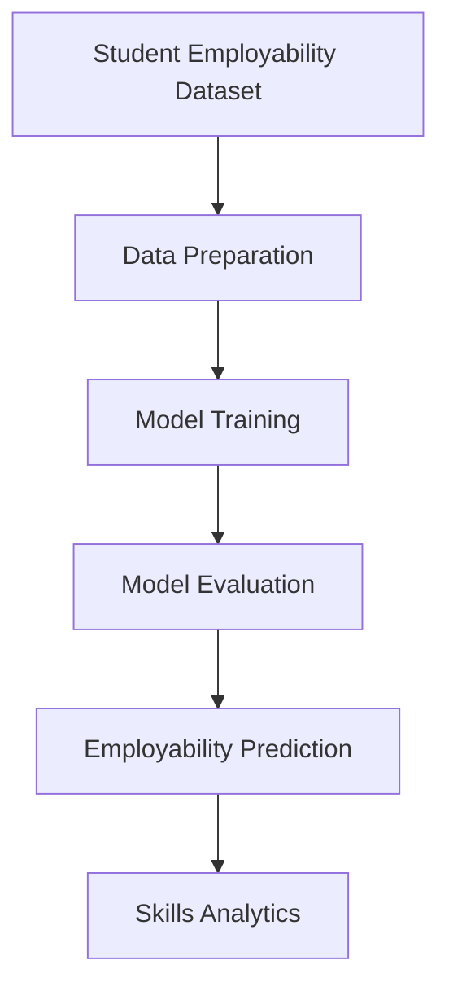

# Selected Specialized Technology: Supervised Machine Learning

Supervised machine learning is a technology for teaching computers to learn patterns from labeled data, and apply them to predict new data. It can be used for this project due to the presence of student-related information that can be analysed to find patterns related to employability.

Machine Learning-Based Student Employability Prediction and Skills Analytics will look into ways of predicting student employability and identifying which skills among the available ones are related to the prediction and/or which student attributes are related.

# Fundamental Concepts

## Understanding how supervised machine learning works.

Supervised Machine Learning relies on a set of data with the outputs known. Input variables are known as features and the output the model tries to predict is known as the target label.

Technical skills, communication skills, academic outcomes and internship experience are all features used in this project, depending on the data that is being used. The target could be an employability category or employment outcome, depending on the available data.

This is done in the following stages:

Data collection: Secure appropriate student employability data.

Data preparation: Check missing values, correct data formats and prepare the features and target label.

Model training: Give the algorithm the opportunity to learn patterns from the training data.

Model evaluation: Evaluate the trained model using data that was not used to train the model.

Prediction and skills analytics: Use the model to predict an outcome, and analyse relevant features to see if there are any patterns of skill.

## Simple Workflow Diagram

## Key Concepts

Features: The variables that are fed into the model; these variables are the skills or internship experience if available.

The goal to predict, given labelled by the target.

The data that is fed into the algorithm for it to learn patterns.

Testing data: Data that is not used to build the model; it is used to test the model's performance.

Classification: If the target is categorical, then a machine learning task where a prediction is made to a category or employability class.

Model evaluation: Measuring performance using suitable metrics, such as accuracy, precision, recall and F1-score.

The accuracy and validity of the prediction are dependent on the data set. The system should not claim to predict employment success if it is not based on actual outcomes of employment but only on an employability score.

# Models, Methods and Tools.

## Decision Tree

A Decision Tree is a model that predicts the outcome by going through a series of conditions given the input features. For instance, it can break down data based on the availability of a particular skill or experience. The prediction process can be relatively easy to follow due to its tree-like organization.

Project uses: It can be used as a candidate classification model and can be used to illustrate the contribution of various features to prediction decisions.

## Random Forest

Random Forest uses many decision trees and takes an average of their predictions to determine the final prediction. The generalisation performance can be boosted by using more than one tree, but not all of the time, depending on the dataset and model attributes.

For use in this project: It can be used as other candidate model for predict employability and compared with other model employability prediction, which is Decision Tree with same testing data.

## Scikit-learn

Scikit-learn is a machine learning library for Python, containing tools for preparing data, training models, making predictions and assessing model performance. Contains implementations of algorithms like Decision Tree and Random Forest.

It can be applied to consistently implement and evaluate the selected models in this project.

These models and tools will be explored and not assumed to be effective in advance. The final model should be chosen in terms of model performance and the availability of data.

# How it fit the Problem

## How the Technology Addresses the Problem

Student may be challenged to grasp the connection of their current skills to employment and may struggle with identifying areas that they could enhance. A machine learning model trained with patterns of historical student-related information could be useful because it would be able to process patterns from the past and generate an outcome for a new record.

The skills analytics part can also explore relevant features to demonstrate which attributes are correlated with the model's predictions. Such information can assist the students and educators in recognizing areas for further development. But it is important to note that the relationships between features don't necessarily mean that the skill leads to better employment.

## Benefits

Prediction: Able to predict an employability category or other defined outcome based on student data.

Knows how to interpret data and find patterns that may not be evident from examining records thoroughly.

Skills analytics: Provides ways to identify features linked to predictions and facilitate conversations about skills development.

Model comparison: various algorithms can be compared to see which one works best with the chosen dataset.

## Limitations and Risks

Availability of data and its quality: It is important to have a suitable data set with relevant features and the target of the project clearly defined. Inaccurate predictions may be affected by missing or incomplete data or by obsolete data.

Bias and representativeness: If some groups of students or backgrounds are under-represented then there may be less confidence or fairness in the predictions for those groups.

Privacy: Ensure that student information is being treated properly, particularly when it includes personal or sensitive information.

Validity of the predictions: accuracy on one sample does not imply accuracy on others, such as the samples of other institutions or the job market in the future.

In this section, compare the results of this approach to an alternative one.

This can also be an alternative rule-based scoring system, that uses a set of rules to determine points for selected skills or qualifications. Easy to apply and understand, it is very sensitive to the rules and weights chosen by the user.

This project is best suited to supervised machine learning that can learn patterns from labeled data without being completely defined by manually written scoring rules. This is subject to the availability of an appropriate dataset, though. When it is not possible to have a labelled version of the data, a rule-based approach might be more feasible.

# References

1. Google. (n.d.). Machine Learning Crash Course. Google for Developers. https://developers.google.com/machine-learning/crash-course/

2. Breiman, L. (2001). Random forests. Machine Learning, 45, 5–32. https://doi.org/10.1023/A:1010933404324

3. scikit-learn developers. (n.d.). Decision Trees. scikit-learn documentation. https://scikit-learn.org/stable/modules/tree.html